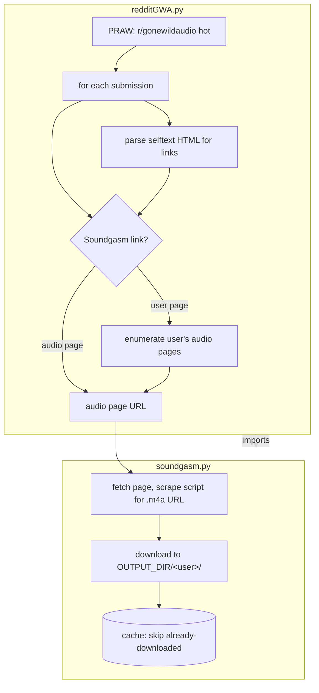

# sound-scraper

> Python scripts to download audio from Soundgasm and Reddit's r/gonewildaudio.

[](LICENSE)
[](https://github.com/chirag127/sound-scraper/stargazers)
[](https://github.com/chirag127/sound-scraper/commits)
[](https://python.org)

**Live site** https://sound-scraper.oriz.in · **GHP landing** https://chirag127.github.io/sound-scraper/ · **Repo** https://github.com/chirag127/sound-scraper

⭐ If this is useful, please star the repo — it helps others find it.

`sound-scraper` is a set of small Python scripts that download audio files. It resolves Soundgasm audio pages to their underlying `.m4a` files and downloads them, and it uses the Reddit API (PRAW) to walk r/gonewildaudio posts, extract the Soundgasm links they contain, and download those. The audio is adult (NSFW) content; this repository contains only the scraping code and downloads nothing until you run it.

## Flow



## Scripts

| Script | Description |
|---|---|
| `soundgasm.py` | Resolve a soundgasm.net user page or individual audio page to its `.m4a` and download it; caches URLs already fetched and streams files to disk. Import it or edit the `users` list to run standalone. |
| `redditGWA.py` | Use PRAW to iterate r/gonewildaudio posts, extract Soundgasm links (direct URLs and links inside post HTML), and hand them to `soundgasm.py`. |
| `4chan_scraper.py` | Minimal stub: lists 4chan boards and their threads via `basc_py4chan`. |

## Tech stack

Real dependencies from `requirements.txt`:

| Dependency | Use |
|---|---|
| `praw` | Reddit API client |
| `beautifulsoup4` | parse Soundgasm pages and Reddit post HTML |
| `requests` | HTTP downloads (with retry adapter) |
| `tqdm` | progress bars |
| `basc_py4chan` | 4chan board/thread listing (stub) |

Requires Python 3.10+.

## Repo structure

```
sound-scraper/
├── requirements.txt
├── soundgasm.py           # Soundgasm page → .m4a downloader (+ cache)
├── redditGWA.py           # r/gonewildaudio crawler → soundgasm.py
├── 4chan_scraper.py       # board/thread listing stub
├── praw.ini.example       # Reddit API credential template
└── .env.example           # output-directory env template
```

## Quick start

```bash
pip install -r requirements.txt

# Reddit API credentials (create a "script" app at reddit.com/prefs/apps)
cp praw.ini.example praw.ini
# edit praw.ini with your client_id / client_secret / user_agent
```

## Usage

```bash
# download from Soundgasm (edit the `users` list in the script, or import its functions)
python soundgasm.py

# crawl r/gonewildaudio and download the Soundgasm audio it links to
python redditGWA.py
```

Downloaded files are written to `SOUNDGASM_OUTPUT_DIR/<user>/` (default `~/audio/Soundgasm`), and a cache file prevents re-downloading the same audio page.

## Configuration

Env-var **names + purpose** only — never commit real credentials.

| Variable | Purpose |
|---|---|
| `SOUNDGASM_OUTPUT_DIR` | directory where downloaded audio is saved (default `~/audio/Soundgasm`) |

`praw.ini` (Reddit API credentials — keep it out of version control):

| Key | Purpose |
|---|---|
| `client_id` | Reddit app client ID |
| `client_secret` | Reddit app client secret |
| `user_agent` | descriptive user-agent string |

## Part of the oriz family

One of ~80 sites and tools in the oriz family. See [blog.oriz.in](https://blog.oriz.in).

## Contributing

Issues and PRs welcome. Keep changes minimal and never commit credentials.

## Status

Maintained as a personal utility.

## License

MIT © Chirag Singhal — chirag@oriz.in

Conventional commits are the changelog.
